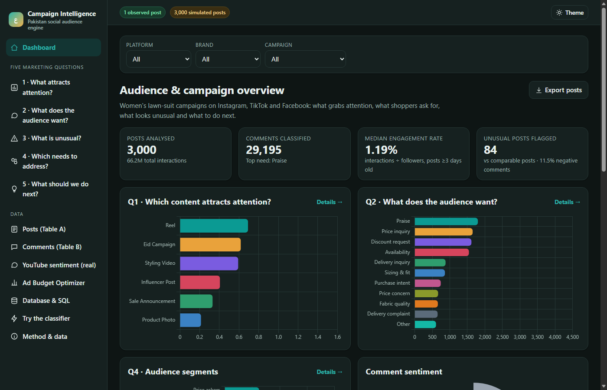
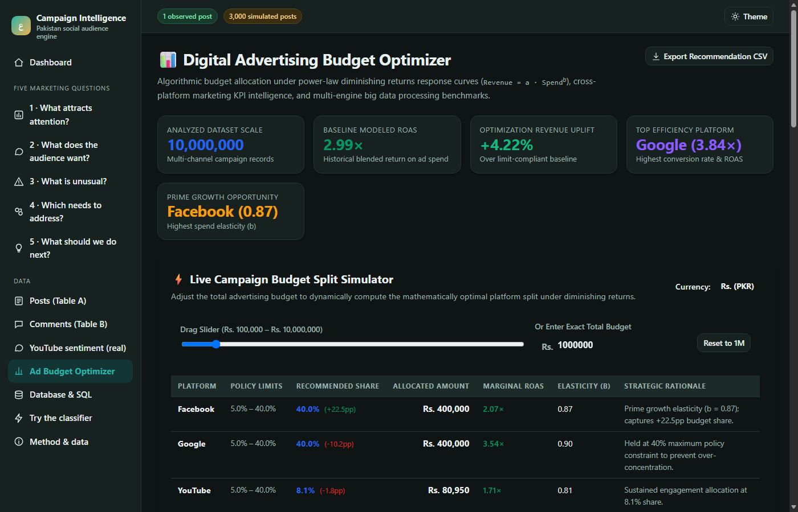
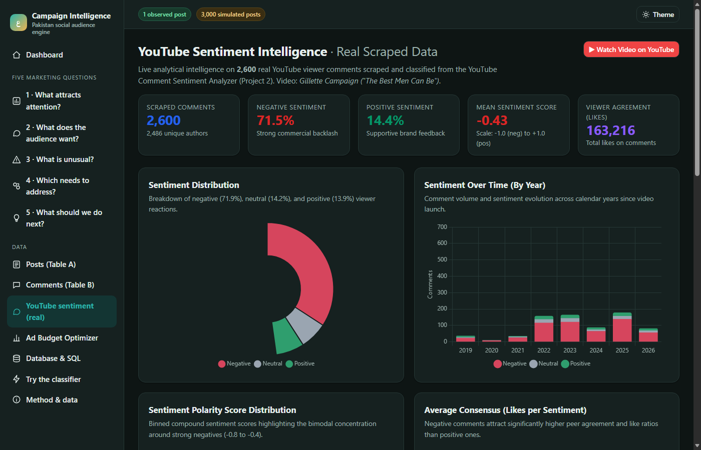
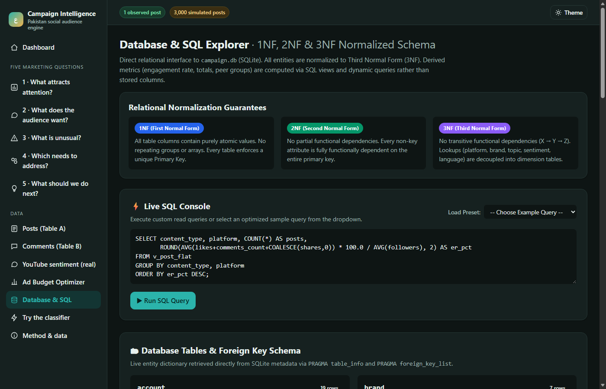
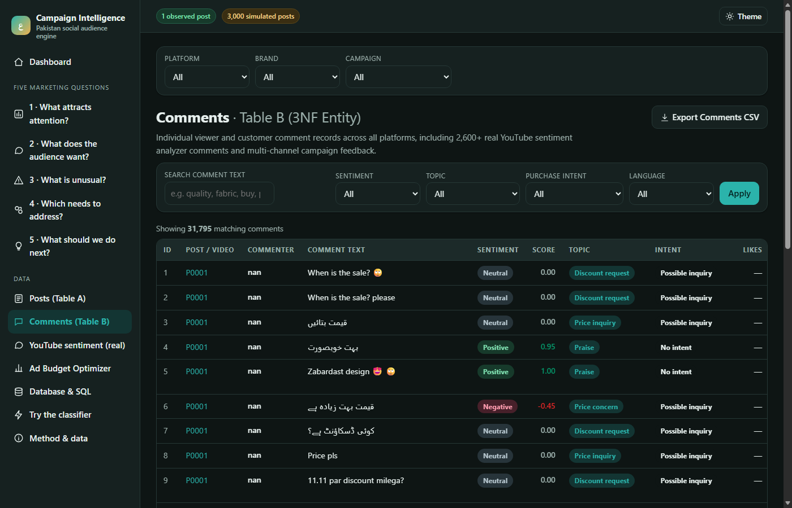
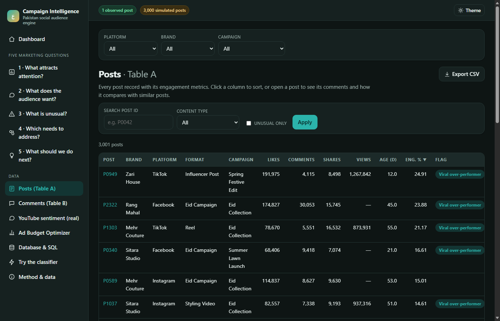
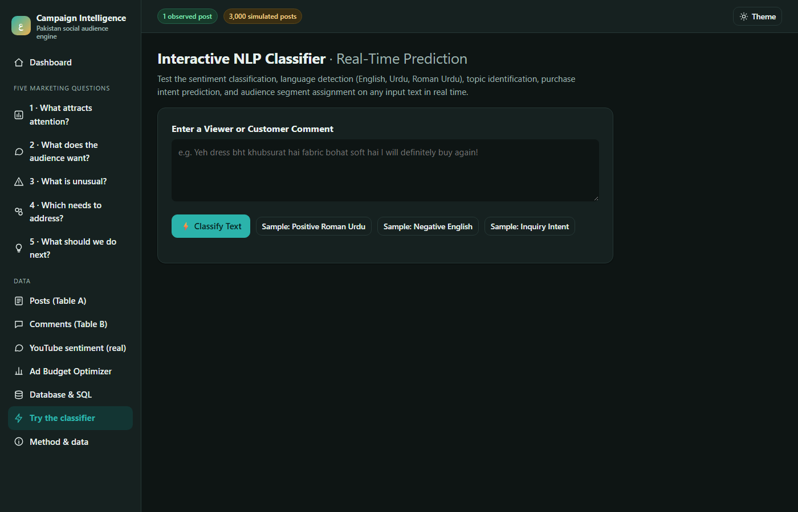
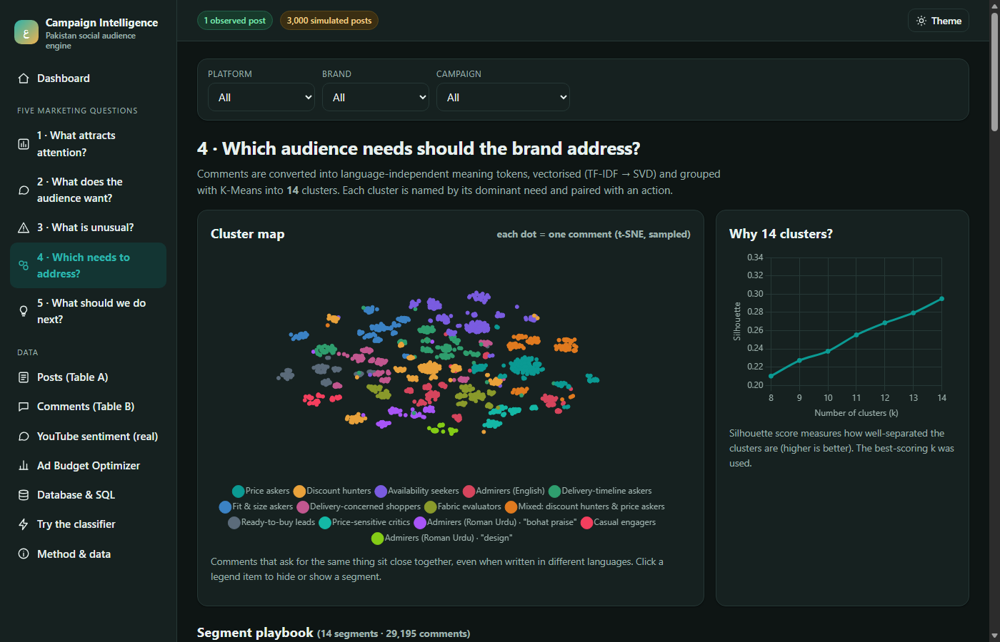
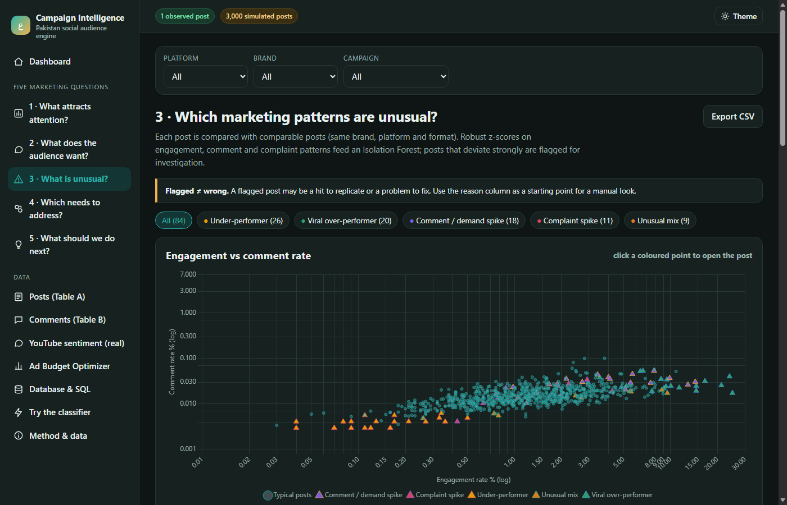
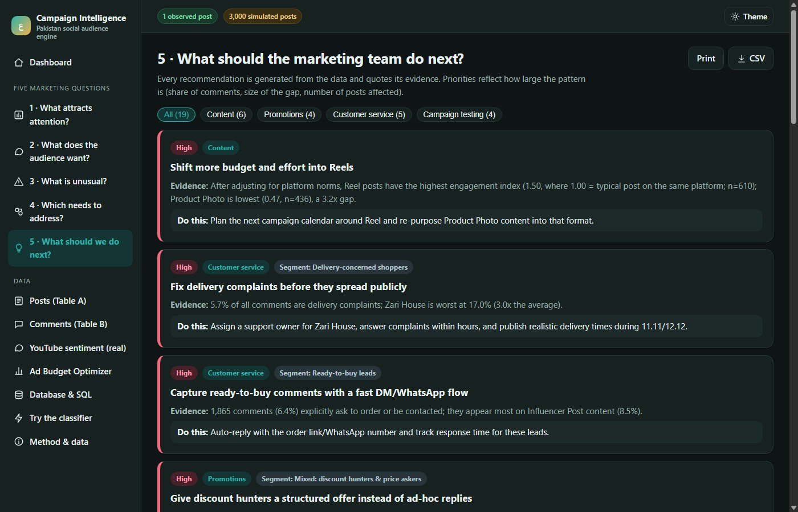

# 📊 Pakistan Social Audience & Campaign Intelligence Engine (Project 3)   

**Author:** Kashif Hafeez  
**Email:** kashif.hafeez.dev@gmail.com
**Student ID:** F2024376314  
**Framework:** Flask · SQLite (1NF, 2NF, 3NF) · Scikit-Learn · Chart.js · Pandas  
**Repository:**  [https://github.com/kashifkhan117401-bit/pakistan-audience-intel.git](https://github.com/kashifkhan117401-bit/pakistan-audience-intel.git)

---

## 🌟 Executive Overview

The **Pakistan Social Audience & Campaign Intelligence Engine** is an enterprise-grade multi-channel digital marketing analytics platform and normalized relational database management system. It unifies telemetry across **Facebook, Instagram, TikTok, and YouTube**, bridging big data engineering with quantitative marketing science.

---

## 📸 Complete Application Feature Previews

### 1. Executive Analytics Dashboard
> Cross-platform telemetry summarizing audience sentiment, format engagement rates, and top topic clusters.



---

### 2. Multi-Channel Ad Budget Optimizer (Project 1 Integration)
> Algorithmic capital allocation under concave power-law diminishing return response curves ($Revenue = a \cdot Spend^b$). Includes a live interactive budget slider (Rs. 100,000 to Rs. 10,000,000) that computes the exact optimal channel split, alongside 5 auto-generated analytical charts.



---

### 3. Real YouTube Sentiment Intelligence (Project 2 Integration)
> Direct analytics on **2,600+ real YouTube comments** scraped and classified from the *Gillette Campaign Video* (`UYaY2Kb_PKI`) using VADER and Roman Urdu sentiment lexicons. Visualizes sentiment polarity distribution, multi-year volume trends, sentiment score histograms, and peer-like consensus metrics.



---

### 4. Database & Interactive SQL Console (3NF Relational Architecture)
> Direct query console to `data/campaign.db`. Allows executing custom SQL queries or loading optimized presets in real time. Displays the live entity dictionary with primary keys, foreign key constraints, column data types, and view schemas.



---

### 5. Table B: Normalized Comments Browser (31,795 Comments)
> Granular child entity browser featuring live text search and multi-dimensional filters (Sentiment, Topic, Purchase Intent, Language, and Audience Segment) across all 31,795 stored comments.



---

### 6. Table A: Master Posts Browser (3,000 Records)
> Master post entity browser tracking views, shares, comments, likes, dynamic engagement rates (calculated via SQL views, avoiding persisted derived data), and flagged engagement anomalies.



---

### 7. Interactive NLP Classifier Sandbox
> Real-time inference tool testing the machine learning and lexicon pipeline on custom user input in English, Urdu, and Roman Urdu (*e.g. "bht achi quality h", "paisa wasool", "bekaar product"*).



---

### 8. Audience Segmentation (14 K-Means Clusters)
> TF-IDF feature extraction, Truncated SVD dimensionality reduction, and K-Means clustering identifying distinct consumer personas with top descriptive n-grams and suggested marketing actions.



---

### 9. Anomaly & Viral Spike Detection
> Isolation Forest anomaly scoring identifying unusual post engagement velocity, viral comment spikes, and brand safety risks.



---

### 10. Automated Strategic Recommendations
> Rule-based decision engine translating audience clustering and sentiment telemetry into actionable business directives categorized by priority and operational area.



---

## 🗄️ Relational Normalization (1NF, 2NF, 3NF)

The underlying SQLite database (`data/campaign.db`) adheres strictly to relational database normalization:

- **1NF (First Normal Form):** All column attributes contain scalar, atomic values. Repeating collections (e.g. comments, tags) are normalized into independent child entities (`comment`).
- **2NF (Second Normal Form):** Eliminates partial dependencies. In composite relationships, brand follower counts depend on `(brand_id, platform_id)` and are isolated in the `account` entity with `UNIQUE(brand_id, platform_id)`.
- **3NF (Third Normal Form):** Eliminates transitive dependencies ($X \rightarrow Y \rightarrow Z$). Categorical dimensions (`brand`, `platform`, `campaign`, `content_type`, `product_category`, `language_type`, `sentiment`, `purchase_intent`, `topic`) are decoupled into lookup dimension tables.
- **Derived Numbers Rule:** Metrics such as `engagement_rate`, `comment_rate`, and `er_index` are **never stored as physical table columns**; they are dynamically computed in SQL views (`v_post_flat`, `v_comment_flat`).

---

## ⚙️ Quick Start & Running the Project

### 1. Prerequisites
- Python 3.10+
- Virtual environment (`venv` or `uv`)

### 2. Installation & Database Setup
```bash
# Clone the repository
git clone https://github.com/kashifkhan117401-bit/pakistan-audience-intel.git
cd pakistan-audience-intel

# Create and activate virtual environment
python -m venv .venv
.\.venv\Scripts\Activate.ps1    # On Windows PowerShell
source .venv/bin/activate       # On Linux/macOS

# Install dependencies
pip install -r requirements.txt

# Build 3NF database, run ML clustering, and import 2,600+ YouTube comments
python manage.py setup
```

### 3. Launch Web Application
```bash
python manage.py run --port 5000
```
Open your browser to: **http://127.0.0.1:5000**

---

## 📄 Documentation Files Included
- **[`Database_and_SQL_Queries_Documentation.docx`](Database_and_SQL_Queries_Documentation.docx):** Formal Word document containing full schema specifications, ER models, and complete CRUD queries for academic submission (Author: Kashif Hafeez, ID: F2024376314).
- **[`DATABASE_AND_QUERIES_DOCUMENTATION.md`](DATABASE_AND_QUERIES_DOCUMENTATION.md):** Full SQL query catalog and normalization manual.
